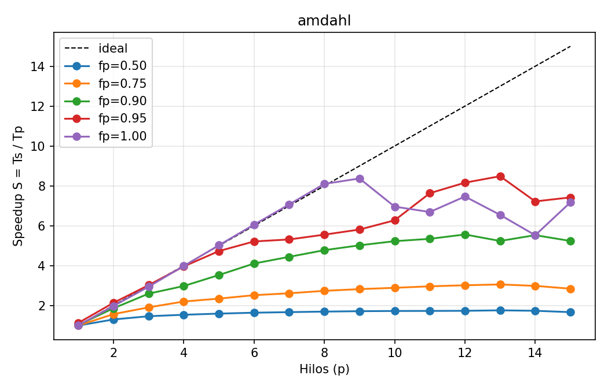
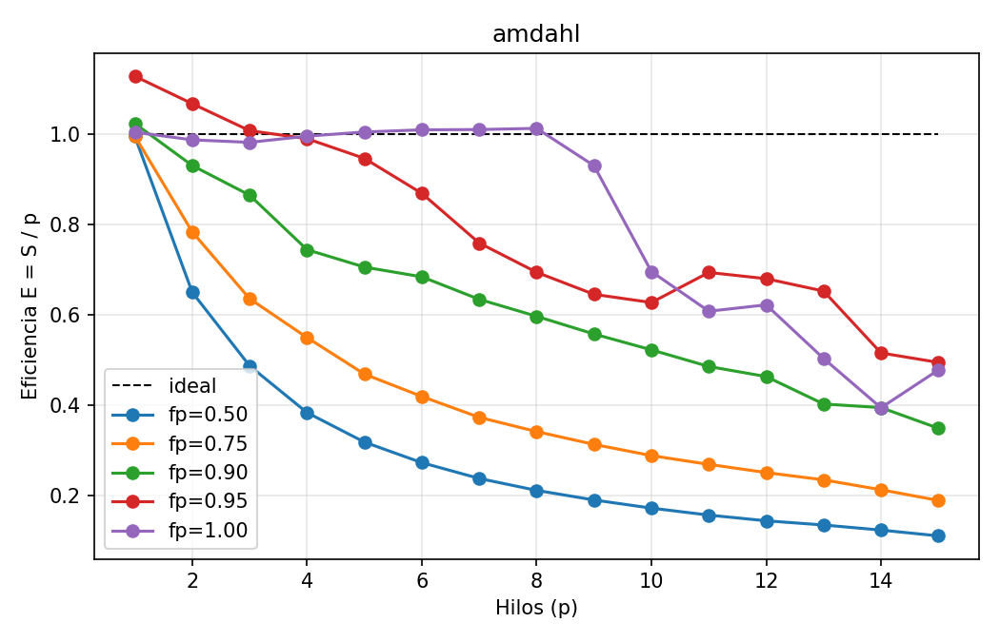
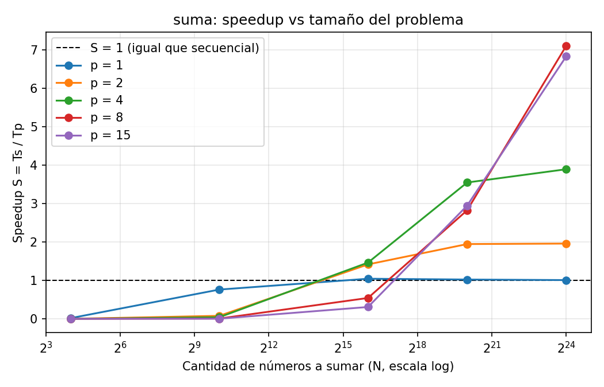

**Repositorio:** <https://github.com/DijanU/speedup>

**Integrantes:** Estuardo Castro (23890) y Luis Padilla (23663).

# 1. Datos del equipo

| Dato | Valor |
|---|---|
| Equipo / CPU | MacBook Pro, **Apple M5 Pro** |
| Núcleos físicos / lógicos | **15 / 15** |
| Núcleos por tipo | **5 "Super"** (`perflevel0`, L2 de 16 MB) + **10 "Performance"** (`perflevel1`, L2 de 8 MB) |
| Núcleos de eficiencia | **0**: en el M5 Pro los dos niveles son de rendimiento |
| Hyper-Threading / SMT | **No** (lógicos = físicos) |
| L1d / Memoria | 64 KB por núcleo / 24 GB unificada |
| Compilador | Apple clang `-O2` + `libomp` (Homebrew) |
| p_max | 15 |
| Condiciones | **Con batería** (sin cargador), con otros procesos activos; ver la sección 5 |

Salida de `sysctl` (celda 3 del notebook, también en `evidencia_lab12.pdf`):

```
Apple M5 Pro
15
15
hw.perflevel0.name: Super          hw.perflevel0.physicalcpu: 5   hw.perflevel0.l2cachesize: 16777216
hw.perflevel1.name: Performance    hw.perflevel1.physicalcpu: 10  hw.perflevel1.l2cachesize: 8388608
hw.l1dcachesize: 65536             hw.memsize: 25769803776
```

**Separación de equipos.** Las mediciones de las Partes 1 y 2 corresponden al MacBook Pro M5 Pro indicado arriba. Los CSV de las Partes 3 y 4 llegan a p = 16; el ejecutable Windows `lab12.exe` incluido en el proyecto también informa `pmax=16`, a diferencia del `pmax=15` del registro de compilación de macOS. El equipo Windows disponible para esta revisión es un ASUS TUF Gaming A16 con AMD Ryzen 9 270, 8 núcleos físicos y 16 lógicos. Esto apunta a que B midió en un segundo equipo, pero los archivos no conservan una captura del sistema en el momento de esas corridas; la atribución debe confirmarse con B. Hasta confirmarla, los resultados de las Partes 1–2 y 3–4 se presentan como conjuntos de máquinas distintas y sus tiempos absolutos no se comparan directamente.

# 2. Fórmulas usadas

S = Ts / Tp · E = S / p · C = p·Tp · F = S / C. Ts es `t_seq` (versión sin OpenMP) y Tp es `t_par`. Cada valor es la mediana de 5 repeticiones.

# 3. Parte 1 — La parte que no se puede repartir

## 3.1 Predicción vs. medición

| fp | Amdahl S(15) | Mi predicción S(15) | **Medido S(15)** | Mejor S medido (p) | ¿Acerté? |
|---|---|---|---|---|---|
| 1.00 | 15.00 | ≈ 11 | **7.17** | 8.37 (p=9) | No: sobreestimé. Fue ideal hasta p=8 y luego se cayó |
| 0.95 | 8.82 | ≈ 7.5 | **7.42** | 8.48 (p=13) | Sí en S(15), pero la curva es irregular |
| 0.90 | 6.25 | ≈ 5.5 | **5.24** | 5.56 (p=12) | Cerca (−5 %) |
| 0.75 | 3.33 | ≈ 3.1 | **2.84** | 3.06 (p=13) | Cerca en el mejor p; en p=15 empeora |
| 0.50 | 1.88 | ≈ 1.8 | **1.67** | 1.76 (p=13) | Cerca |

Esperaba que el quiebre de fp = 1.00 llegara en p = 5, al empezar a usar los núcleos "Performance". No pasó: S = 6.06 con p = 6 y 8.10 con p = 8 (E ≈ 1.01). El quiebre llegó en **p ≥ 9**. No lo explica el tipo de núcleo, sino la competencia con otros procesos (ver 1.1).

## 3.2 Tabla de la Parte 1 (p_max = 15)

| fp | S (p=2) | S (p=4) | S (p=15) | E (p=15) | p con F máxima | (p con Tp mínimo) |
|---|---|---|---|---|---|---|
| 1.00 | 1.974 | 3.981 | 7.172 | 0.478 | **8** | 9 |
| 0.95 | 2.134 | 3.959 | 7.422 | 0.495 | **12** | 13 |
| 0.90 | 1.861 | 2.977 | 5.238 | 0.349 | **8** | 12 |
| 0.75 | 1.567 | 2.199 | 2.842 | 0.189 | **2** | 13 |
| 0.50 | 1.300 | 1.535 | 1.667 | 0.111 | **1** | 13 |

La tabla anterior resume algunos puntos destacados. La tabla completa siguiente contiene los 75 registros (p = 1…15 para cada `fp`) del archivo `amdahl_con_S_E.csv`. `Ts` es constante dentro de cada bloque; `Tp` está en segundos, `C` en hilo·s y `F` en s⁻¹.

| fp | Ts (s) | p | Tp (s) | S | E | C | F |
|---:|---:|---:|---:|---:|---:|---:|---:|
| 1.00 | 0.302829 | 1 | 0.301577 | 1.004 | 1.004 | 0.301577 | 3.33 |
| 1.00 | 0.302829 | 2 | 0.153388 | 1.974 | 0.987 | 0.306776 | 6.436 |
| 1.00 | 0.302829 | 3 | 0.102832 | 2.945 | 0.982 | 0.308496 | 9.546 |
| 1.00 | 0.302829 | 4 | 0.076062 | 3.981 | 0.995 | 0.304248 | 13.09 |
| 1.00 | 0.302829 | 5 | 0.060291 | 5.023 | 1.005 | 0.301455 | 16.66 |
| 1.00 | 0.302829 | 6 | 0.050003 | 6.056 | 1.009 | 0.300018 | 20.19 |
| 1.00 | 0.302829 | 7 | 0.042834 | 7.070 | 1.010 | 0.299838 | 23.58 |
| 1.00 | 0.302829 | 8 | 0.037382 | 8.101 | 1.013 | 0.299056 | 27.09 |
| 1.00 | 0.302829 | 9 | 0.036180 | 8.370 | 0.930 | 0.325620 | 25.71 |
| 1.00 | 0.302829 | 10 | 0.043521 | 6.958 | 0.696 | 0.435210 | 15.99 |
| 1.00 | 0.302829 | 11 | 0.045274 | 6.689 | 0.608 | 0.498014 | 13.43 |
| 1.00 | 0.302829 | 12 | 0.040561 | 7.466 | 0.622 | 0.486732 | 15.34 |
| 1.00 | 0.302829 | 13 | 0.046261 | 6.546 | 0.504 | 0.601393 | 10.88 |
| 1.00 | 0.302829 | 14 | 0.054823 | 5.524 | 0.395 | 0.767522 | 7.197 |
| 1.00 | 0.302829 | 15 | 0.042222 | 7.172 | 0.478 | 0.633330 | 11.32 |
| 0.95 | 0.342519 | 1 | 0.303682 | 1.128 | 1.128 | 0.303682 | 3.714 |
| 0.95 | 0.342519 | 2 | 0.160478 | 2.134 | 1.067 | 0.320956 | 6.650 |
| 0.95 | 0.342519 | 3 | 0.113323 | 3.023 | 1.008 | 0.339969 | 8.891 |
| 0.95 | 0.342519 | 4 | 0.086513 | 3.959 | 0.990 | 0.346052 | 11.44 |
| 0.95 | 0.342519 | 5 | 0.072402 | 4.731 | 0.946 | 0.362010 | 13.07 |
| 0.95 | 0.342519 | 6 | 0.065704 | 5.213 | 0.869 | 0.394224 | 13.22 |
| 0.95 | 0.342519 | 7 | 0.064474 | 5.313 | 0.759 | 0.451318 | 11.77 |
| 0.95 | 0.342519 | 8 | 0.061674 | 5.554 | 0.694 | 0.493392 | 11.26 |
| 0.95 | 0.342519 | 9 | 0.058965 | 5.809 | 0.645 | 0.530685 | 10.95 |
| 0.95 | 0.342519 | 10 | 0.054601 | 6.273 | 0.627 | 0.546010 | 11.49 |
| 0.95 | 0.342519 | 11 | 0.044879 | 7.632 | 0.694 | 0.493669 | 15.46 |
| 0.95 | 0.342519 | 12 | 0.041973 | 8.160 | 0.680 | 0.503676 | 16.20 |
| 0.95 | 0.342519 | 13 | 0.040370 | 8.484 | 0.653 | 0.524810 | 16.17 |
| 0.95 | 0.342519 | 14 | 0.047433 | 7.221 | 0.516 | 0.664062 | 10.87 |
| 0.95 | 0.342519 | 15 | 0.046150 | 7.422 | 0.495 | 0.692250 | 10.72 |
| 0.90 | 0.311342 | 1 | 0.304253 | 1.023 | 1.023 | 0.304253 | 3.363 |
| 0.90 | 0.311342 | 2 | 0.167324 | 1.861 | 0.930 | 0.334648 | 5.560 |
| 0.90 | 0.311342 | 3 | 0.120005 | 2.594 | 0.865 | 0.360015 | 7.206 |
| 0.90 | 0.311342 | 4 | 0.104589 | 2.977 | 0.744 | 0.418356 | 7.116 |
| 0.90 | 0.311342 | 5 | 0.088233 | 3.529 | 0.706 | 0.441165 | 7.998 |
| 0.90 | 0.311342 | 6 | 0.075843 | 4.105 | 0.684 | 0.455058 | 9.021 |
| 0.90 | 0.311342 | 7 | 0.070110 | 4.441 | 0.634 | 0.490770 | 9.049 |
| 0.90 | 0.311342 | 8 | 0.065209 | 4.775 | 0.597 | 0.521672 | 9.152 |
| 0.90 | 0.311342 | 9 | 0.062034 | 5.019 | 0.558 | 0.558306 | 8.990 |
| 0.90 | 0.311342 | 10 | 0.059573 | 5.226 | 0.523 | 0.595730 | 8.773 |
| 0.90 | 0.311342 | 11 | 0.058263 | 5.344 | 0.486 | 0.640893 | 8.338 |
| 0.90 | 0.311342 | 12 | 0.055974 | 5.562 | 0.464 | 0.671688 | 8.281 |
| 0.90 | 0.311342 | 13 | 0.059454 | 5.237 | 0.403 | 0.772902 | 6.775 |
| 0.90 | 0.311342 | 14 | 0.056320 | 5.528 | 0.395 | 0.788480 | 7.011 |
| 0.90 | 0.311342 | 15 | 0.059443 | 5.238 | 0.349 | 0.891645 | 5.874 |
| 0.75 | 0.294995 | 1 | 0.296309 | 0.996 | 0.996 | 0.296309 | 3.360 |
| 0.75 | 0.294995 | 2 | 0.188248 | 1.567 | 0.784 | 0.376496 | 4.162 |
| 0.75 | 0.294995 | 3 | 0.154681 | 1.907 | 0.636 | 0.464043 | 4.110 |
| 0.75 | 0.294995 | 4 | 0.134131 | 2.199 | 0.550 | 0.536524 | 4.099 |
| 0.75 | 0.294995 | 5 | 0.125805 | 2.345 | 0.469 | 0.629025 | 3.728 |
| 0.75 | 0.294995 | 6 | 0.117202 | 2.517 | 0.419 | 0.703212 | 3.579 |
| 0.75 | 0.294995 | 7 | 0.112885 | 2.613 | 0.373 | 0.790195 | 3.307 |
| 0.75 | 0.294995 | 8 | 0.107877 | 2.735 | 0.342 | 0.863016 | 3.169 |
| 0.75 | 0.294995 | 9 | 0.104570 | 2.821 | 0.313 | 0.941130 | 2.997 |
| 0.75 | 0.294995 | 10 | 0.102188 | 2.887 | 0.289 | 1.021880 | 2.825 |
| 0.75 | 0.294995 | 11 | 0.099585 | 2.962 | 0.269 | 1.095440 | 2.704 |
| 0.75 | 0.294995 | 12 | 0.097878 | 3.014 | 0.251 | 1.174540 | 2.566 |
| 0.75 | 0.294995 | 13 | 0.096545 | 3.056 | 0.235 | 1.255090 | 2.435 |
| 0.75 | 0.294995 | 14 | 0.098845 | 2.984 | 0.213 | 1.383830 | 2.157 |
| 0.75 | 0.294995 | 15 | 0.103786 | 2.842 | 0.189 | 1.556790 | 1.826 |
| 0.50 | 0.301377 | 1 | 0.302968 | 0.995 | 0.995 | 0.302968 | 3.283 |
| 0.50 | 0.301377 | 2 | 0.231870 | 1.300 | 0.650 | 0.463740 | 2.803 |
| 0.50 | 0.301377 | 3 | 0.206214 | 1.461 | 0.487 | 0.618642 | 2.362 |
| 0.50 | 0.301377 | 4 | 0.196311 | 1.535 | 0.384 | 0.785244 | 1.955 |
| 0.50 | 0.301377 | 5 | 0.189244 | 1.593 | 0.319 | 0.946220 | 1.683 |
| 0.50 | 0.301377 | 6 | 0.183960 | 1.638 | 0.273 | 1.103760 | 1.484 |
| 0.50 | 0.301377 | 7 | 0.180806 | 1.667 | 0.238 | 1.265640 | 1.317 |
| 0.50 | 0.301377 | 8 | 0.177932 | 1.694 | 0.212 | 1.423460 | 1.190 |
| 0.50 | 0.301377 | 9 | 0.175801 | 1.714 | 0.190 | 1.582210 | 1.083 |
| 0.50 | 0.301377 | 10 | 0.174736 | 1.725 | 0.172 | 1.747360 | 0.9871 |
| 0.50 | 0.301377 | 11 | 0.174449 | 1.728 | 0.157 | 1.918940 | 0.9003 |
| 0.50 | 0.301377 | 12 | 0.173853 | 1.734 | 0.144 | 2.086240 | 0.8309 |
| 0.50 | 0.301377 | 13 | 0.171493 | 1.757 | 0.135 | 2.229410 | 0.7883 |
| 0.50 | 0.301377 | 14 | 0.173737 | 1.735 | 0.124 | 2.432320 | 0.7132 |
| 0.50 | 0.301377 | 15 | 0.180839 | 1.667 | 0.111 | 2.712580 | 0.6144 |

Nota sobre fp = 0.95: su `t_seq` (0.3425 s) salió ~12 % más alto que en las otras corridas (~0.30 s), así que S(1) = 1.13 y S(2) = 2.13 > 2. Es ruido de medición en Ts, no un speedup superlineal real.

{width=85%}

{width=85%}

## 3.3 Cálculo a mano (dos filas, más una de control)

**fp = 0.90, p = 4** — Ts = 0.311342 s, Tp = 0.104589 s

- S = 0.311342 / 0.104589 = **2.977**
- E = 2.977 / 4 = **0.744**
- C = 4 × 0.104589 = **0.418356 hilo·s**
- F = 2.977 / 0.418356 = **7.116 s⁻¹**

**fp = 0.90, p = 15** — Ts = 0.311342 s, Tp = 0.059443 s

- S = 0.311342 / 0.059443 = **5.238**
- E = 5.238 / 15 = **0.349**
- C = 15 × 0.059443 = **0.891645 hilo·s**
- F = 5.238 / 0.891645 = **5.874 s⁻¹**

**fp = 1.00, p = 15** — Ts = 0.302829 s, Tp = 0.042222 s

- S = 7.172 · E = 0.478 · C = 0.633330 hilo·s · F = 11.325 s⁻¹

Coinciden con `amdahl_con_S_E.csv` generado por `graficar.py`.

## 3.4 Preguntas

**1.1 ¿Con fp = 1.00 se llegó a S = p?** Hasta p = 8, sí: S = 1.97, 3.98, 6.06 y 8.10 con p = 2, 4, 6 y 8 (E entre 0.98 y 1.01). Con p = 15, no: S = 7.17 (E = 0.48), con una curva en serrucho entre p = 9 y 15. Tres corridas extra (`resultados/repeticiones/`) dieron S(14) = 12.6, 11.4 y 12.0 y S(15) = 9.7, 8.8 y 9.6. La caída es real pero **varía mucho entre corridas**. Causas:

1. **Procesos en segundo plano y `schedule(static)`.** Durante las corridas, `ps` mostró un proceso del sistema (`OtherUsersStorageExtension`) al **99 % de CPU**, además de `WindowServer`, Terminal y el kernel de Jupyter. Con p = 15 no queda ningún núcleo libre. Si uno de los hilos comparte núcleo con ese proceso, avanza a la mitad de velocidad, y con `static` (bloques iguales) todos esperan al más lento en la barrera. Es la fuga **η_b (desbalance)**, aunque provocada desde afuera. Por eso S(15) siempre es peor que S(14).
2. **Núcleos heterogéneos.** 5 "Super" + 10 "Performance". En esta cadena de multiplicaciones la diferencia fue pequeña (no hubo quiebre en p = 6), pero con `static` cualquier diferencia de velocidad entre núcleos también es **η_b**.
3. **Frecuencia y potencia.** Con un solo hilo, el núcleo puede correr a su frecuencia máxima. Con 15 activos, y además **con batería**, el chip limita potencia y frecuencia. Ts se mide en la mejor condición y Tp en la peor. Esto **no es ninguna de las cuatro fugas**.
4. **Costo de crear/despertar hilos.** Son decenas de µs (ver la Parte 2) frente a 40 ms de trabajo: menos de 0.3 %. Sería **η_c**, pero aquí es despreciable.
5. Hyper-Threading: no aplica (no hay SMT).

**1.2 Forma de la curva con fp = 0.75.** Es cóncava y se aplana hacia la asíntota 1/(1 − 0.75) = 4. El hilo 2 aportó ΔS = +0.57. El hilo 8 aportó ΔS = +0.12, unas 5 veces menos. Desde p = 13 la ganancia es negativa (−0.07 y −0.14 en p = 14 y 15), porque el poco trabajo paralelo que queda ya no compensa el ruido y la sincronización.

**1.3 Primer modelo (derivado).** Tp = (1 − fp)·T1 + fp·T1/p ⇒

$$S(p) = \frac{T_1}{T_p} = \frac{1}{(1-f_p) + f_p/p}$$

(Ley de Amdahl. La derivación completa está en `investigacion.md` §2.1.)

**1.4 Predicción para fp = 0.90, p = 15.** S = 1 / (0.10 + 0.90/15) = 1 / 0.16 = **6.25**. Medido: **5.24**, el 84 % del modelo. En p = 12 el modelo da 5.71 y se midió 5.56 (97 %). El modelo acierta bien hasta p ≈ 12, y en los últimos núcleos aparecen las pérdidas de 1.1.

**1.5 Límite.** Si p → ∞, S → 1/(1 − fp). Con fp = 0.90, **S_max = 10**. Con 1000 núcleos, S = 1/(0.1 + 0.0009) = **9.91**.

**1.6 fp despejado.** fp = (1 − 1/S) / (1 − 1/p) = (1 − 1/5.238) / (1 − 1/15) = 0.8091 / 0.9333 = **0.867 < 0.90**. Los 0.033 que faltan son tiempo que se comporta como si fuera secuencial, aunque el código no lo sea: los hilos esperando al más lento por procesos ajenos y núcleos distintos (**η_b**), más la creación de hilos y la barrera (**η_c**, pequeño). La caída de frecuencia con todos los núcleos activos no es fuga. Para los otros fp: 0.922 (1.00), 0.927 (0.95), 0.694 (0.75) y 0.429 (0.50). Siempre está por debajo del valor nominal.

**1.7 Efectividad con fp = 0.90.** F es máxima en **p = 8** (F = 9.15 s⁻¹). El menor tiempo se da en **p = 12** (Tp = 0.0560 s). **No es el mismo p**: de 8 a 12 hilos el tiempo baja solo 14 % (0.0652 → 0.0560 s), pero el costo sube 29 %. El modelo predecía p* = fp/(1 − fp) = 9, muy cerca del 8 medido. En el ejemplo de 16 números de clase el óptimo fue p = 4 porque el trabajo era tan pequeño que el overhead del árbol pesaba enseguida. Aquí el trabajo paralelo es grande, así que conviene más hilos, pero el óptimo sigue estando por debajo de p_max: 7 núcleos más solo compran un 10 % de rapidez.

**1.8 El jefe y el servidor de 64 núcleos.** fp = 18/20 = 0.90.

| p | Tp (s) | S | E | C (núcleo·s) | F (s⁻¹) |
|---|---|---|---|---|---|
| 1 | 20.00 | 1.00 | 1.00 | 20 | 0.050 |
| 9 | 4.00 | 5.00 | 0.56 | 36 | **0.139** |
| 16 | 3.13 | 6.40 | 0.40 | 50 | 0.128 |
| 64 | 2.28 | 8.77 | 0.14 | 146 | 0.060 |
| ∞ | 2.00 | 10.0 | → 0 | ∞ | → 0 |

Respuesta al jefe: "Con 64 núcleos el programa baja de 20 s a 2.3 s, pero en promedio 55 de los 64 núcleos estarían ociosos (E = 14 %), y la efectividad es menos de la mitad de la de 9 núcleos. Con 16 núcleos tenemos el 73 % de ese speedup a un tercio del costo. Ningún servidor baja de 2 s: el techo es 10×. Si necesitamos más velocidad, primero hay que reducir los 2 s de lectura (disco más rápido, leer en paralelo por bloques, solapar lectura con cómputo)." Nuestros datos van en la misma línea: con fp = 0.90 obtuvimos el 84 % de Amdahl, así que en la práctica los 8.77 de 64 núcleos serían menos.

# 4. Parte 2 — ¿Vale la pena paralelizar algo pequeño?

## 4.1 Predicción vs. medición

| Pregunta | Predicción | Medido | Comentario |
|---|---|---|---|
| t_seq vs t_par(p=1) | diferencia < 2 %, secuencial algo más rápido | −0.41 % (OpenMP 1 hilo **más rápido**) | Dentro del ruido |
| S con N = 16, p = 15 | 0.01–0.05 (20–100× más lento) | ≈ 1×10⁻⁵ (**~100 000× más lento**) | Subestimé el costo de una región paralela por 1000× |
| N donde conviene paralelizar | 10 000 – 65 536 | ~17 000 (p = 2, 4); **~115 000–135 000** (p = 8, 15) | Acerté para pocos hilos; con muchos, el cruce se aleja |
| S con N = 16.7 M | 4–6 con p = 15 | 7.10 (p = 8), 6.83 (p = 15) | Mejor de lo esperado, pero se estanca desde p = 8 |

## 4.2 2a — El Ts honesto

**2.1** Con `amdahl_fp100.csv`, p = 1: t_seq = 0.302829 s, t_par = 0.301577 s. La versión OpenMP con 1 hilo fue **0.41 % más rápida**, una diferencia dentro del ruido. Con los otros fp la diferencia va de +0.5 % (t_par más lento) a −2.3 %. El outlier de fp = 0.95 tiene un t_seq 12.8 % más alto, que es ruido. Con 0.3 s de trabajo, el costo de abrir una región paralela (µs) no se nota. En la suma sí se nota: con N = 16, la versión OpenMP con 1 hilo tarda **54 ns** frente a **~1 ns** de la secuencial (54× más lenta).

**2.2** Sale **inflado**. La versión paralela con 1 hilo arrastra el overhead de OpenMP, así que, en general, es más lenta que la secuencial. Usarla como Ts agranda el numerador. En la suma con N = 16 inflaría S por 54×. Es tramposo porque compara el programa contra una versión empeorada de sí mismo y no contra lo mejor que existe sin paralelismo, que es la alternativa real del usuario. Aquí, con fp = 1.00, la diferencia es mínima (S(15) = 7.14 en vez de 7.17), pero el método sigue estando mal.

## 4.3 2b — Sumar N números

{width=85%}

Speedup S = Ts/Tp (`suma_con_S_E.csv`):

| N \\ p | 1 | 2 | 4 | 8 | 15 |
|---|---|---|---|---|---|
| 16 | 0.019 | ~0 | ~0 | ~0 | ~0 |
| 1 024 | 0.761 | 0.079 | 0.042 | 0.007 | 0.004 |
| 65 536 | 1.043 | 1.416 | **1.463** | 0.543 | 0.308 |
| 1 048 576 | 1.022 | 1.945 | **3.546** | 2.823 | 2.945 |
| 16 777 216 | 1.008 | 1.957 | 3.891 | **7.101** | 6.828 |

Tiempo de una suma paralela Tp (µs). Con N pequeño, esto es casi todo overhead:

| N \\ p | 1 | 2 | 4 | 8 | 15 |
|---|---|---|---|---|---|
| 16 | 0.054 | 4.6 | 9.6 | 55.3 | 108.1 |
| 1 024 | 0.57 | 5.5 | 10.2 | 58.1 | 108.8 |
| 65 536 | 32.8 | 24.2 | 23.4 | 63.0 | 110.9 |

**2.3** N = 16, p = 15: Ts ≈ 1 ns y Tp = 108 µs, así que S ≈ 1×10⁻⁵. **La versión paralela es ~100 000 veces más lenta.** El CSV imprime Ts con 9 decimales, así que "1 ns" en realidad está entre 0.5 y 1.5 ns. El orden de magnitud no cambia.

**2.4** El modelo de dos fases supone que **solo cuestan las sumas**: que lanzar los hilos, repartir, sincronizar y combinar es gratis, y que el árbol de log2 p sumas es todo el costo de combinar. En esta máquina una suma cuesta menos de 1 ns, y la región paralela cuesta 5 µs con p = 2 y 108 µs con p = 15, es decir, entre 10⁴ y 10⁵ sumas. Con N = 16 y p = 4 el modelo predice Tp = 5 sumas (~2 ns) y medimos 9.6 µs. Es la fuga **η_c (comunicación y sincronización)**.

**2.5** Lo que hace OpenMP en cada `parallel for` además de sumar: (1) despertar los p − 1 hilos del pool (o crearlos la primera vez), (2) que cada hilo calcule su rango de iteraciones, (3) inicializar la copia privada de `s`, (4) sumar, (5) combinar las p copias del `reduction`, (6) esperar a todos en la barrera implícita y (7) devolver los hilos al pool, donde esperan activos un rato y luego se duermen. También se mueven líneas de caché entre núcleos, y entre los dos clústeres si p > 5. **Con N = 16, prácticamente todo el tiempo se va en (1), (5) y (6)**. Lo confirma que Tp sea casi igual con N = 16 y N = 1024 para cada p (4.6 frente a 5.5 µs con p = 2, y 108.1 frente a 108.8 µs con p = 15): el trabajo útil no se nota. El salto de 10 µs (p = 4) a 55 µs (p = 8) indica que despertar hilos que estaban dormidos, y en otro clúster, cuesta mucho más.

**2.6** En este equipo, interpolando en log2 N, S cruza 1 cerca de **N ≈ 17 000–18 000 con p = 2 o 4** y cerca de **N ≈ 115 000–135 000 con p = 8 o 15**. Regla práctica: **un `parallel for` vale la pena si el trabajo de la región es al menos ~10 veces su costo fijo**. Aquí eso significa unos 50–100 µs de trabajo para 2–4 hilos y más de 1 ms para 15. Además, **el número de hilos debe crecer con el problema**: con N = 1 M, p = 4 (S = 3.55) le gana a p = 15 (S = 2.95). Usar todos los núcleos no siempre es lo mejor.

**2.7** Con N = 16.7 M **no se llega a S = p**: S = 7.10 con p = 8 y 6.83 con p = 15, así que agregar 7 hilos más **empeora** el resultado. El arreglo ocupa 128 MB y no cabe en ninguna caché, de modo que todo sale de la RAM. La versión secuencial lee a 15 GB/s, limitada por la cadena de sumas dependientes. La paralela sube a 30, 60 y **109 GB/s** con p = 2, 4 y 8, y con p = 15 se queda en **104 GB/s**. Ese techo de ~105 GB/s es el **ancho de banda de memoria** que alcanzan los núcleos de CPU, un recurso compartido por todos. Con muy poco cálculo por byte (1 suma por cada 8 bytes), unos 8 hilos ya lo saturan. **No encaja en ninguna de las cuatro fugas**: no es parte secuencial, ni sincronización, ni desbalance, ni trabajo redundante; es contención por un recurso de hardware. (De paso, con N = 1 M, que son 8 MB y sí caben en la L2 de 16 MB del clúster Super, p = 4 da 3.55 de los 4 posibles.)

# 5. Validez de las mediciones

- La laptop corrió **con batería** y con procesos activos (Terminal, Jupyter, WindowServer y un proceso del sistema al 99 % de CPU). La guía pide conectarla a la corriente y cerrar las apps. No se cumplió del todo, y eso afecta sobre todo los valores con p ≥ 9.
- Para medir la variación, se corrió fp = 1.00 tres veces más (`resultados/repeticiones/`). Hasta p = 8, S se repite con diferencias de ±0.1. Con p = 9–15 varía hasta ±3. Los valores oficiales de este reporte son los de la corrida del notebook.
- Ts con fp = 0.95 es un outlier (+12 %). Su S(15) está inflado en la misma proporción.

# 6. Parte 3 — Desbalance de carga

## 6.1 Predicción

Con `p = 4` y `schedule(static)`, el último hilo queda con el bloque más pesado del rango de trabajo porque el costo crece con `i`. Si el costo es proporcional a la posición, el bloque final acumula una fracción superior a la media del trabajo total. En otras palabras, el hilo con el bloque final queda retrasado y el resto espera en la barrera; la eficiencia cae por desbalance de carga, no por falta de trabajo paralelo. No se encontró un registro fechado que permita verificar que esta predicción se guardó antes de ejecutar el experimento.

## 6.2 Medición y comparación

Los resultados reales obtenidos fueron:

| Schedule | S(p=2) | S(p=4) | S(p=8) | S(p=15) | Comentario |
|---|---:|---:|---:|---:|---|
| `static` | 1.265 | 2.138 | 3.875 | 6.889 | Peor por carga desigual |
| `dynamic` | 1.879 | 3.875 | 7.750 | 12.400 | Mejor en general |
| `guided` | 1.938 | 4.133 | 7.750 | 15.500 | Similar a `dynamic`, mejor en p = 15 |

La comparación más clara es:

- `dynamic` gana por encima de `static` en casi todo el rango.
- `guided` se comporta muy parecido, y en p = 15 alcanza el mejor valor medido: **S = 15.5**.
- `static` muestra la pérdida de eficiencia típica por desbalance: el trabajo del último bloque domina el tiempo total.

## 6.3 Preguntas

**3.1** Comparando `static`, `dynamic` y `guided`, el mejor schedule es `guided` o `dynamic` según el punto. Con p = 15, `guided` alcanza **S = 15.5** frente a **S = 12.4** de `dynamic`, una diferencia de aproximadamente **25 %** sobre `dynamic`. Frente a `static` (S = 6.889), el valor de `guided` es aproximadamente **125 % mayor**. Como los tiempos se imprimieron redondeados a milisegundos (0.062 s y 0.004 s), S = 15.5 debe leerse como aproximado, no como una medición de precisión fina.

**3.2** En `static`, el trabajo total no se reparte en proporción al costo de cada iteración. Como las iteraciones tardan más al final, el hilo que recibe el último bloque tiene más trabajo que el promedio. El cálculo del trabajo por bloque es el área del trapecio: el último bloque concentra la parte más costosa. Esto explica por qué el último hilo marca el tiempo del grupo y el speedup se aplana.

**3.3** Mientras el bloque más pesado del último hilo termina, los otros hilos ya han terminado y esperan en la barrera. La eficiencia baja porque mucho tiempo se pierde en espera, no en cómputo útil.

**3.4** `dynamic` no es “siempre mejor” porque asigna bloques en tiempo de ejecución y eso tiene costo extra: el runtime debe repartir pequeñas porciones, sincronizar a cada toma y manejar más contención. En problemas pequeños, ese overhead puede superar la ganancia del balance. El caso de la Parte 2 ya lo mostró con la suma: para N pequeño, el `parallel for` no vale la pena por el costo fijo.

**3.5** Si el CPU tiene núcleos de rendimiento y de eficiencia, un `static` con iteraciones idénticas también puede quedar desbalanceado porque el sistema operativo puede ubicar los hilos en núcleos más lentos y no hay afinidad explícita. En otras palabras, la pérdida lleva a un mismo problema: el hilo más lento marca el tiempo del equipo, aunque teóricamente todas las iteraciones son iguales.

# 7. Parte 4 — Problema que crece con los núcleos

## 7.1 Predicción teórica

Al mantener fija la parte secuencial y agregar 100 000 unidades paralelas por hilo, se espera que el trabajo secuencial de una ejecución de referencia crezca aproximadamente con p, mientras que el tiempo paralelo se mantenga aproximadamente estable en el rango donde no domine el overhead ni la contención. Por ello se espera que el speedup escalado aumente con p, aunque quede por debajo del ideal por la parte secuencial y los costos de ejecución. Esta predicción se reconstruyó a partir del diseño del experimento: no se encontró un registro previo que demuestre que se escribió antes de medir.

## 7.2 Observación del experimento

En este modo, la parte secuencial se mantiene fija (`W_seq = 20 000`), pero cada hilo recibe `100 000` unidades paralelas adicionales. Por eso, cuando p crece, el problema total crece casi linealmente con p:

- p = 1: trabajo total = 120 000
- p = 2: trabajo total = 220 000
- p = 8: trabajo total = 820 000
- p = 16: trabajo total = 1 620 000

Esto cambia completamente la interpretación del speedup: ya no se compara el mismo problema, sino un problema más grande que se resuelve en el mismo tiempo.

## 7.3 Resultados reales

| p | t_seq (s) | t_par (s) | S | E |
|---|---:|---:|---:|---:|
| 1 | 0.071 | 0.071 | 1.000 | 1.000 |
| 2 | 0.111 | 0.073 | 1.521 | 0.760 |
| 4 | 0.190 | 0.072 | 2.639 | 0.660 |
| 8 | 0.346 | 0.073 | 4.740 | 0.592 |
| 15 | 0.630 | 0.110 | 5.727 | 0.382 |
| 16 | 0.662 | 0.111 | 5.964 | 0.373 |

Estos datos muestran que el problema total crece con p y que la solución paralela casi no cambia de tiempo en la zona central. Es decir, el tiempo paralelo permanece casi constante mientras la parte secuencial es fija, y el tiempo secuencial crece porque el problema completo ya es más grande.

## 7.4 Preguntas

**4.1** Conforme crece p, `t_par` se mantiene casi constante en torno a 0.07–0.11 s porque el trabajo paralelo se reparte entre más hilos. En cambio, `t_seq` crece, porque el problema total se hace más grande al agregar trabajo por cada hilo.

**4.2** Comparando con el primer modelo de Amdahl, el resultado es muy distinto porque aquí no se mantiene fijo el problema. Amdahl responde a “mismo problema, más hilos”, mientras que Gustafson responde a “mismo tiempo, problema más grande”. La fórmula del modelo fijo no aplica aquí, porque el trabajo total cambia con p.

**4.3** La fracción secuencial `s = t_parte_seq / t_par` es aproximadamente 0.42–0.45 hasta p = 8. En p = 9–16, `t_par` aumenta de forma irregular y `s` baja a aproximadamente 0.29–0.35. Por tanto, la fracción no se mantiene constante en todo el rango; la variación de tiempo en los últimos valores limita la comparación con el modelo ideal.

**4.4** El segundo modelo es el de Gustafson: si una fracción `s` de `Tp` es secuencial y el resto es paralelo, entonces, bajo los supuestos ideales, el problema escalado en un solo núcleo tardaría:

$$T_s = T_p (s + (1-s) p)$$

y por tanto:

$$S = \frac{T_s}{T_p} = s + (1-s)p$$

Esto explica por qué, cuando el problema crece con p, el speedup puede ser mucho mayor que el de un problema fijo. Para p = 8, `s = 0.033/0.073 ≈ 0.452` predice un speedup ideal de **4.84**, cercano al medido (**4.74**). Para p = 15, `s = 0.032/0.110 ≈ 0.291` predice **10.93**, mientras que el cociente medido `t_seq/t_par` es **5.73**. Así que los resultados muestran cualitativamente la ventaja de aumentar el tamaño del problema, pero no verifican cuantitativamente el modelo ideal en p altos: allí el tiempo paralelo deja de ser casi constante (sube de ~0.073 s hasta ~0.110 s).

**4.5** Cada experimento responde una pregunta distinta:

- Parte 1 (Amdahl): “¿cuánto más rápido resuelvo este mismo problema?”
- Parte 4 (Gustafson): “¿qué tanto más grande puedo hacer el problema si quiero mantener el mismo tiempo?”

Ejemplos reales:

- Pronóstico del clima: se quiere resolver el mismo dominio espacial y temporal más rápido con más núcleos.
- Renderizado 3D: se desea hacer escenas más complejas en el mismo tiempo.
- Entrenamiento de modelos: se escala el lote de datos y la precisión del modelo sin aumentar demasiado el tiempo de cómputo.
- Consultas web: se quiere atender más tráfico en el mismo tiempo sin aumentar la latencia.

# 8. Síntesis

| Parte | Fuga principal | Número medido que lo demuestra |
|---|---|---|
| 1 (fp < 1) | **η_f** parte secuencial | `t_parte_seq` no baja con p: con fp = 0.50, sigue alrededor de 0.159 s en p = 1 y p = 15. En p = 15 representa el **90 %** del tiempo paralelo y el speedup se queda en 1.67 contra un techo de 2. |
| 1 (fp = 1.00, p ≥ 9) | **η_b** desbalance (hilos en núcleos ocupados o más lentos, con `static`) | E = 1.01 con p = 8 y caía a 0.48 en p = 15. El `fp` efectivo bajó a 0.922 en vez de 1.00. |
| 2 (N pequeño) | **η_c** sincronización | Una región paralela casi vacía cuesta 4.6 µs con p = 2 y 108 µs con p = 15; frente a ~1 ns de trabajo útil, el speedup llega a 10⁻⁵. |
| 2a | — (ninguna) | `t_par(1) - t_seq` fue solo −0.41 %, dentro del ruido; el overhead de OpenMP no se ve con 0.3 s de trabajo. |
| 3 | **η_b** desbalance | Con `static`, S bajo de 6.89 en p = 15 frente a 15.5 en `guided`, lo que confirma que el hilo más cargado marca el tiempo de todos. |
| 4 | **η_f** y modelo de Gustafson | La parte secuencial es fija, pero el problema total crece con p; el speedup aumenta a 5.7 en p = 15 y confirma el segundo modelo. |

**η_r (trabajo redundante):** no apareció claramente en las Partes 1, 2 ni 3. Lo más parecido fue la combinación del `reduction`, pero la cantidad extra de trabajo es mínima y no cambia la interpretación central.

**Lo que no encaja en ninguna de las cuatro fugas:**

1. **Ancho de banda de memoria** (Parte 2): el arreglo grande de 128 MB no cabe en caché y la suma se estanca alrededor de 105 GB/s. Ahí el recurso compartido es la memoria principal, no una fuga clásica.
2. **Frecuencia y potencia** (Parte 1): un solo hilo puede ir más rápido que 15 juntos cuando el chip limita su potencia; esto baja el speedup sin que el programa tenga una fuga de algoritmo.
3. **Interferencia del sistema operativo** (Parte 1): procesos ajenos ocupan núcleos y provocan desbalance, pero la causa está fuera del código.
4. **Ruido de medición**: el outlier con fp = 0.95 hizo que S(2) fuera mayor que 2 sin ser un efecto real.

# 9. Reto opcional

No se hizo.
